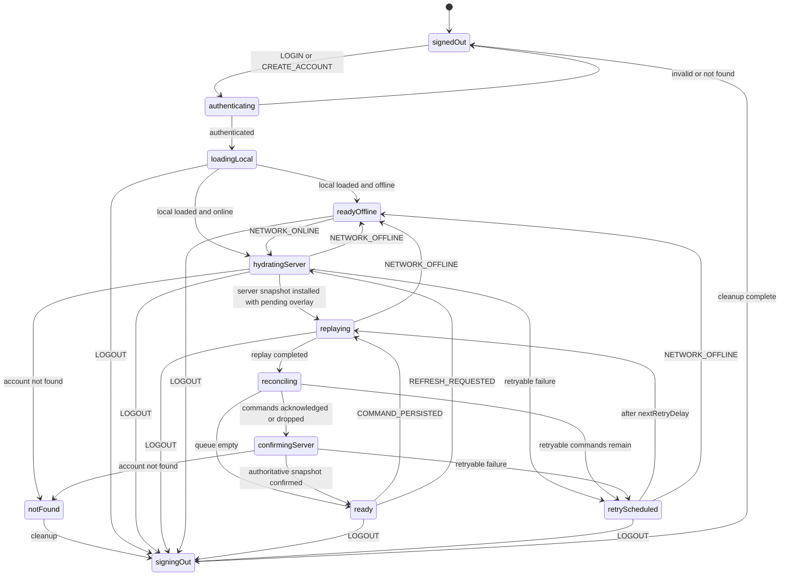

The best improvement is one account-convergence actor with an ordered convergence pipeline—not three initially parallel regions.

Hydration and replay are not truly independent: both affect the same projection. Running them in parallel preserves the race we want to eliminate.

## Main problems today

The current implementation has four important weaknesses:

- Going online independently starts server hydration and the replay scheduler. Their completion order is unspecified in [sync-context.tsx](/Users/lukasmurdock/Documents/GitHub/todoflare/src/contexts/sync-context.tsx:910).
- `accountProjectionRevisionRef` only tracks commands created during the current runtime. It does not protect an optimistic snapshot restored alongside an already-persisted queue.
- Command effects are applied from inside the queue executor callback. Logout or account switching cannot reliably prevent an already-running replay from applying effects to React state.
- `isRealtimeDegraded` pauses account-command replay, even though realtime WebSocket availability and HTTP account convergence are different policies.

That means an online transition can currently hydrate an older server snapshot over offline changes before replay completes.

## Recommended state model



Network availability should be an input to this machine, not a parallel region duplicating global browser policy. Likewise, `REALTIME_DISABLED` should affect column actors but should not automatically pause account HTTP replay.

## Replace revision guards with projection layering

The central model should be:

```ts
visibleProjection = applyPendingCommands(serverBase, durableQueue);
```

A server hydration replaces only `serverBase`. It never directly replaces the visible projection.

This eliminates the question “Can hydration overwrite optimistic changes?” structurally:

- Commands are persisted first.
- The durable queue is the only pending-command source.
- A pure reducer overlays those commands onto the latest server base.
- Acknowledged or terminal commands leave the queue.
- The projection is recomputed automatically.

The projection should be one cohesive value:

```ts
interface AccountProjection {
	account: Account;
	sharedColumns: ColumnMeta[];
	deletedColumns: DeletedColumn[];
	sharedWithByColumn: Record<string, string[] | undefined>;
	publicLinksByColumn: Record<string, PublicLinkResponse | null>;
}
```

This replaces multiple coordinated React setters and most optimistic rollback branches.

## Actor context

Keep only durable identity and convergence data:

```ts
interface AccountConvergenceContext {
	accountId: string | null;
	serverBase: AccountProjection | null;
	projection: AccountProjection | null;
	queueDepth: number;
	lastConvergedAt: number | null;
	lastReplayAt: number | null;
	error: AccountConvergenceError | null;
}
```

Do not copy the full mutation queue into machine context. Read it from `LocalMutationQueueService`, which remains its source of truth.

Errors should be classified rather than stored as arbitrary strings:

```ts
type AccountConvergenceError =
	| { scope: "auth"; kind: "invalid" | "not_found" }
	| { scope: "hydrate"; kind: "offline" | "rate_limited" | "server" }
	| { scope: "replay"; kind: "retryable" | "terminal" }
	| { scope: "access"; kind: "revoked"; columnId: string };
```

## Required service changes

Two changes are important for real cancellation:

1. `LocalMutationQueueService.replay` should accept an immutable `accountId` and `AbortSignal`.
2. Command execution should return effects in the replay report, not apply them immediately through React callbacks.

The actor can then discard a stopped invocation’s result. Fetch calls should use the invocation’s abort signal. Logout or account switching exits the state, aborts outstanding work, and prevents old effects from reaching the replacement session.

Each account actor must receive its account ID as immutable input. Requests should not consult `accountIdRef`; this strengthens cross-account isolation.

## Explicit answers

| Question                                        | Proposed rule                                                                                      |
| ----------------------------------------------- | -------------------------------------------------------------------------------------------------- |
| Can hydration replace an optimistic projection? | No. It replaces the server base; pending durable commands are reapplied.                           |
| What if the account changes during hydration?   | The old actor is stopped and its invoked request is aborted. A new actor owns the new account.     |
| Can logout occur during replay?                 | Yes. It transitions to `signingOut`, aborts replay, stops column actors, and clears session state. |
| What does reconnect do?                         | Hydrate → overlay pending commands → replay → reconcile → confirm server state.                    |
| Which failures retry?                           | Offline, rate limiting, server failures, and explicitly retryable API codes.                       |
| Which failures are terminal?                    | Invalid command, account not found, ownership failure, or access revocation.                       |
| Does realtime degradation pause account replay? | No, unless a separate account-sync policy explicitly says so.                                      |

## Minimal file structure

I would add only:

- `src/lib/sync/account-convergence-machine.ts`
- `src/lib/sync/account-projection.ts`
- `test/account-convergence-machine.test.ts`
- `test/account-projection.test.ts`

Keep the existing queue, executor, and reconciliation contracts where possible. Avoid adding a separate manager until an actual second consumer requires one; `SyncProvider` can own the single account actor.

Once migrated, remove:

- `accountProjectionRevisionRef`
- `accountHydrationGenerationRef`
- `accountIdRef`
- local hydration cancellation flags
- `startReplayScheduler`
- `canApplyAccountHydration`
- queue-result cache refs
- per-operation optimistic rollback branches

## Implementation order

1. Build the pure pending-command projection reducer and characterize every command.
2. Extend replay reports to carry effects without applying them.
3. Add cancellation and account scoping to replay.
4. Implement the convergence machine with simulated-clock tests.
5. Adapt `SyncContext` to select the actor’s projection.
6. Route operations through persist-first command submission.
7. Remove the old refs, scheduler, effects, and rollback code.

The highest-impact step is the projection reducer. It makes hydration safe before the larger lifecycle migration and turns most convergence behavior into deterministic, inexpensive unit tests.
