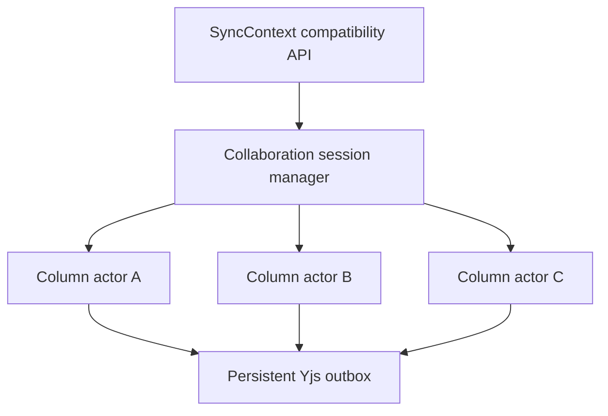
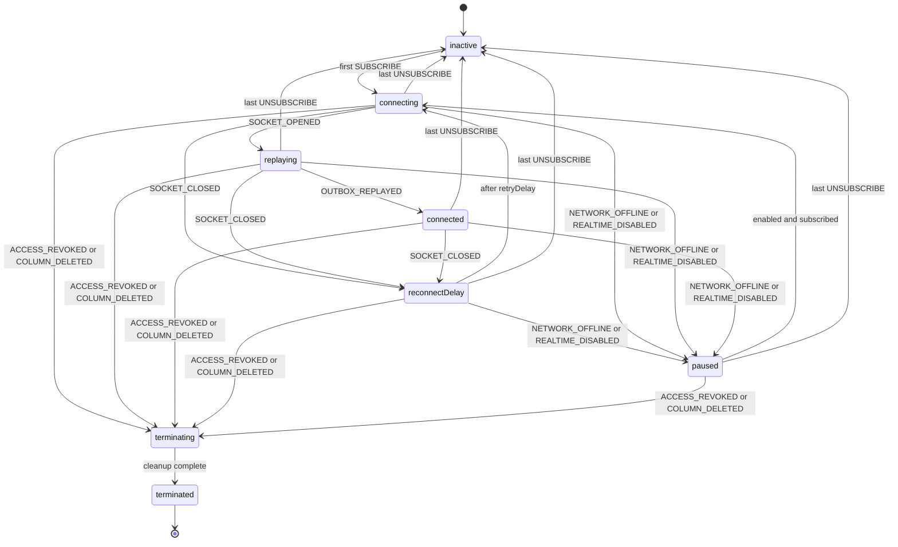

# Per-column collaboration sessions with XState

## Summary

Each collaborative column should have its own XState actor. The actor should
make connection lifecycle races structurally unrepresentable, while a parent
session manager owns account-wide policy and aggregate status.

The design must keep three concerns separate:

1. Per-column connection lifecycle.
2. Global network and realtime availability policy.
3. Durable Yjs delivery guarantees.

Putting all three into one machine would recreate the coupling this change is
intended to remove.

## Implementation entry point

Application code should use `ColumnSessionManager` in
[`column-session-manager.ts`](../../src/lib/sync/column-session-manager.ts). Acquire
a column lease with `subscribeToColumn(columnId)` and call the returned closure
for cleanup. The manager owns the actor registry and policy broadcasts; the
column machine and socket actor are implementation details behind it.

Lifecycle changes belong in
[`column-session-machine.ts`](../../src/lib/sync/column-session-machine.ts), socket
translation belongs in
[`column-socket-actor.ts`](../../src/lib/sync/column-socket-actor.ts), and durable
outbound bytes belong only in
[`yjs-update-outbox.ts`](../../src/lib/sync/yjs-update-outbox.ts).

## Current problem

The current `ColumnConnection` combines socket state, reconnect timers, retry
policy, reference counting, presence, and send buffering in one mutable object
([sync-context.tsx, line 123](../../src/contexts/sync-context.tsx#L123)). Its
behavior is distributed across socket callbacks, timer callbacks, ref-counted
teardown, global degradation, access-loss cleanup, and outbox replay.

The implementation handles races defensively with nonces, identity checks, and
repeated cleanup branches. Those guards are valuable, but they also show that
invalid combinations remain representable, including:

- A `connected` status without a live socket.
- A reconnect timer while reconnection is disabled.
- A stale socket callback mutating its replacement connection.
- Reconnection after access has been revoked or a column deleted.
- A zero-reference connection continuing to retry.

## Design goals

- Give every column one explicit lifecycle owner.
- Make socket and timer cleanup follow state exit automatically.
- Make subscriptions idempotent and safe under repeated React cleanup.
- Stop transport activity synchronously when access is lost.
- Pause retries while the browser is offline.
- Preserve the current `SyncContext` API during incremental migration.
- Keep durable outbox data in one source of truth.
- Make retry, teardown, replay, and terminal behavior deterministic to test.

## Non-goals

- Migrating unrelated account synchronization into XState.
- Moving all Yjs update bytes into machine snapshots.
- Changing the WebSocket wire protocol in the same change as the lifecycle
  migration.
- Replacing simple local React state with actors without a lifecycle reason.

## Recommended topology

Use two actor levels:

- A session manager owns the actor registry, account-wide network/degradation state, and aggregate connection status.
- One column-session actor owns each column’s subscription leases, transport lifecycle, retries, presence, and sending.

`SyncContext` initially remains a compatibility adapter over the manager, so consumers do not need to migrate simultaneously.



This prevents one column’s connection failure from directly disabling every other column.

## Improved column statechart



I would not use `degraded` as a per-column state. Use:

- `paused` when network or global realtime policy prevents connecting.
- `retryExhausted` if an individual column has exhausted a bounded retry policy.
- `REALTIME_DISABLED` as a manager-level policy broadcast.

Currently, three failed initial attempts by one column call
`markRealtimeDegraded`, which then tears down every column
([sync-context.tsx, line 1464](../../src/contexts/sync-context.tsx#L1464),
[sync-context.tsx, line 1491](../../src/contexts/sync-context.tsx#L1491)). Worse,
the retry path does not check `isNetworkOnline`, so going offline can eventually
degrade the entire session. The manager should pause all actors on
`NETWORK_OFFLINE` and resume them on `NETWORK_ONLINE`.

## Event model

Public events should express domain intent. Socket callbacks and invoked work
should produce internal events.

| Event | Source | Purpose |
| --- | --- | --- |
| `SUBSCRIBE { leaseId }` | Session manager | Acquire an idempotent subscription lease. |
| `UNSUBSCRIBE { leaseId }` | Session manager | Release a lease; the last lease returns the actor to `inactive`. |
| `SEND_SYNC { update }` | Yjs provider | Persist a Yjs update before attempting transport. |
| `SEND_AWARENESS { update }` | Presence provider | Send or replace the latest ephemeral awareness update. |
| `NETWORK_OFFLINE` | Session manager | Pause active connection and retry work. |
| `NETWORK_ONLINE` | Session manager | Resume a subscribed, enabled session. |
| `REALTIME_DISABLED` | Session manager | Apply account-wide local-only policy. |
| `REALTIME_ENABLED` | Session manager | Allow subscribed sessions to reconnect. |
| `SOCKET_OPENED` | Socket actor | Enter outbox replay. |
| `SOCKET_CLOSED { code, reason, wasClean }` | Socket actor | Record closure and choose retry behavior. |
| `SOCKET_MESSAGE { message }` | Socket actor | Deliver decoded sync, awareness, presence, or lifecycle data. |
| `OUTBOX_REPLAYED` | Replay effect | Begin ordinary live sending. |
| `ACCESS_REVOKED` | Decoded server message | Terminate the column session as revoked. |
| `COLUMN_DELETED` | Decoded server message | Terminate the column session as deleted. |

`RETRY_ELAPSED` does not need to be part of the public event contract. XState's
named `after` transition can own that timer and cancel it automatically when the
state exits.

## Invoke the socket instead of storing it

The socket should be a `fromCallback` actor invoked while the session is in the `connecting`, `replaying`, or `connected` compound state.

It should:

- Create the `WebSocket`.
- Translate callbacks into `SOCKET_OPENED`, `SOCKET_CLOSED`, and `SOCKET_MESSAGE`.
- Receive outbound `SEND_FRAME` events.
- Remove handlers and close the socket in its cleanup function.

That eliminates these fields:

- `ws`
- `reconnectTimeout`
- `shouldReconnect`
- `nonce`

XState ignores `sendBack` calls after an invoked callback actor has stopped
([callback.ts, line 202](../../repos/xstate/packages/core/src/actors/callback.ts#L202)).
This directly replaces the hand-written nonce and object-identity guards at
[sync-context.tsx, line 1367](../../src/contexts/sync-context.tsx#L1367).

Use a named XState delay for exponential backoff:

```ts
delays: {
	retryDelay: ({ context }) =>
		Math.min(1_000 * 2 ** context.retryAttempt, 30_000),
}
```

This makes cancellation automatic when the machine leaves `reconnectDelay` and makes retry behavior testable with a simulated clock.

## Replace `refCount` with subscription leases

A numeric ref count can be corrupted by duplicated subscriptions or repeated cleanup. Give every subscriber a stable lease:

```ts
{
	type: "SUBSCRIBE";
	leaseId: string;
}
{
	type: "UNSUBSCRIBE";
	leaseId: string;
}
```

Store a `ReadonlySet<string>` in context. Adding or removing the same lease twice becomes idempotent.

Ideally the public API becomes:

```ts
const unsubscribe = subscribeToColumn(columnId);
```

The returned closure owns its lease ID. `SyncContext` exposes this lease API
directly so consumers do not coordinate separate connect and disconnect calls.

## Keep durable messages outside machine context

I would not put all buffered Yjs bytes in XState context. The durable outbox is already the source of truth; duplicating it inside snapshots creates two queues that must be reconciled.

Suggested context:

```ts
interface ColumnSessionContext {
	accountId: string;
	columnId: string;
	leases: ReadonlySet<string>;
	retryAttempt: number;
	hasConnected: boolean;
	presence: PresenceUser[];
	pendingAwareness: Uint8Array | null;
	lastClose: {
		code: number;
		reason: string;
		wasClean: boolean;
	} | null;
	terminationReason: "revoked" | "column_deleted" | null;
}
```

Rules:

- `SEND_SYNC` persists to the outbox first.
- While disconnected or replaying, the durable outbox is the buffer.
- On connection, enter `replaying` and send entries in stable outbox order.
- Awareness is ephemeral: retain only its latest value and expire it quickly.
- Do not begin ordinary live sending until replay finishes, avoiding replay/live ordering races.

## Fix “acknowledgement” semantics separately

The current best-effort policy removes an outbox entry when `WebSocket.send()`
returns successfully
([yjs-update-outbox.ts](../../src/lib/sync/yjs-update-outbox.ts),
[sync-context.tsx](../../src/contexts/sync-context.tsx)). The method is named
`removeAfterSocketWrite` to make clear that the browser accepted the bytes; it
does not mean the server applied them.

The protocol has no ACK opcode
([websocket-protocol.ts, line 3](../../src/lib/collaboration/websocket-protocol.ts#L3)).

Choose explicitly between:

1. Best-effort delivery: rename `acknowledge` to `removeAfterSocketWrite` and document the weaker guarantee.
2. Persistent delivery: add a client message ID and server `SYNC_ACK` frame. Keep sync entries until the ACK arrives. Because Yjs updates are idempotent, reconnect replay remains safe.

I recommend the second option, but as a separate change from the XState migration. Mixing a client lifecycle rewrite with a wire-protocol change would make failures much harder to isolate.

## Make access loss terminal immediately

Currently, access-loss handling waits for asynchronous mutation cleanup before
detaching the socket
([sync-context.tsx, line 929](../../src/contexts/sync-context.tsx#L929),
[sync-context.tsx, line 976](../../src/contexts/sync-context.tsx#L976)). During that
interval, the session can still receive or enqueue work.

Instead:

1. Transition synchronously to `terminating`.
2. Exiting the socket state immediately closes the transport and prevents sends/retries.
3. Invoke the account projection and outbox cleanup.
4. Notify the manager of the terminal result.
5. Enter final `terminated`.

Terminal states should reject `SUBSCRIBE`, `SEND_SYNC`, and `SEND_AWARENESS`. A newly granted access session must create a new actor rather than revive the terminal one.

## Required invariants

The implementation and its tests should demonstrate these invariants:

1. `connected` is reachable only while the current invoked socket is open.
2. At most one socket actor exists for a column session.
3. Leaving `reconnectDelay` cancels its delayed transition.
4. A stopped socket actor cannot affect its former parent session.
5. The last subscription lease stops connection and retry work.
6. Offline or globally disabled sessions do not consume retry attempts.
7. Access loss closes the transport before asynchronous cleanup begins.
8. Terminal sessions never reconnect or accept new outbound work.
9. Sync updates are persisted before they are submitted to the transport.
10. Outbox entries are removed only according to the documented delivery
    guarantee.
11. Failure in one column does not disable unrelated columns without an explicit
    manager policy decision.

## Suggested file boundaries

- `src/lib/sync/column-socket-actor.ts`: WebSocket callback actor and transport
  event translation.
- `src/lib/sync/column-session-machine.ts`: One column's lifecycle, leases,
  retry policy, presence, and replay coordination.
- `src/lib/sync/column-session-manager.ts`: Actor registry, network/global policy,
  and aggregate status.
- `src/contexts/sync-context.tsx`: React compatibility adapter and account-level
  projection effects.
- `src/lib/sync/yjs-update-outbox.ts`: The sole durable outbound update store.

## Suggested implementation sequence

1. Add characterization tests around the current socket, retry, teardown, and outbox behavior.
2. Create `column-socket-actor.ts` with an injectable socket factory.
3. Create `column-session-machine.ts` and test it with a simulated clock and fake outbox.
4. Add `column-session-manager.ts` and adapt the existing `SyncContext` methods to it.
5. Replace numeric reference counting with lease-based subscriptions.
6. Move global offline/degradation policy into the manager.
7. Remove the old `ColumnConnection` map and callback/timer machinery.
8. Separately add protocol-level sync acknowledgements.

The success criterion should not merely be fewer lines in `sync-context.tsx`. It should be that each invalid combination becomes structurally unrepresentable and each race has one deterministic machine test.
