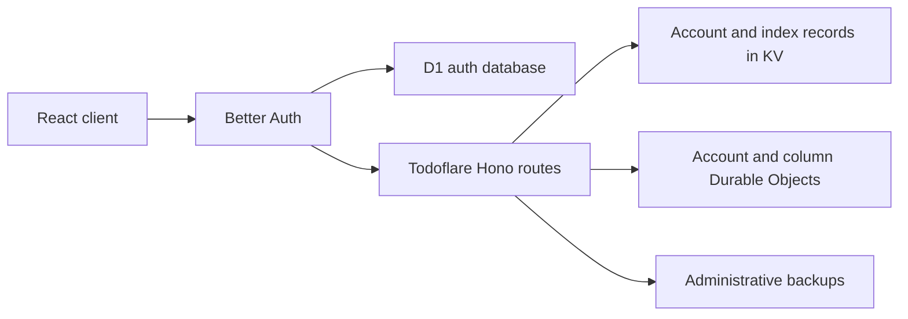

# Passkey authentication with Better Auth

Status: Implemented

Date: 2026-07-22

## Summary

Todoflare should stop using its 16-digit account ID as a bearer credential. The
account ID should become a public sharing identity, while passkeys become the
primary authentication method.

The proposed implementation uses Better Auth with its Anonymous and Passkey
plugins, backed by a dedicated Cloudflare D1 database. Better Auth owns users,
passkeys, authentication ceremonies, and sessions. Existing Todoflare storage
continues to own columns, sharing ACLs, local-first state, and backups.

The Anonymous plugin is used only as a temporary server-side bootstrap after a
user explicitly chooses to create a synced account. It is not used for ordinary
guest-local mode. A provisional anonymous user becomes a permanent synced
account only after a passkey has been registered successfully.

## Problem

The current 16-digit account ID has two incompatible responsibilities:

- It is the identifier used by column ownership, sharing ACLs, presence, account
  projections, and offline queues.
- It is also the bearer credential accepted by private API routes.

Sharing therefore requires a user to disclose a value that can authenticate as
their entire account. The same value also appears in column metadata and
realtime presence.

Changing only the sharing form would not fix the problem. Authentication and
identity must be separated throughout the application.

## Decision

Use the following identity model:

| Concept | Purpose | Exposure |
| --- | --- | --- |
| Account ID | Stable domain identity, sharing, ACLs, presence, offline partitioning | Public |
| Passkey | Primary authentication credential | Private key remains with authenticator |
| Session cookie | Authenticates normal HTTP requests after passkey verification | HttpOnly |
| Recovery code | Emergency recovery when all passkeys are unavailable | Secret |

Keep the existing account ID representation and storage keys. Account IDs are public identities and never authenticate.

Use Better Auth rather than integrating SimpleWebAuthn directly. Better Auth's
Passkey plugin uses SimpleWebAuthn internally and also supplies the surrounding
challenge, cookie-session, credential-management, and revocation behavior.

## Completed account transition

The production owner enrolled a passkey on 2026-10-01. The temporary migration
bridge is retired. Only passkey cookie sessions and recovery codes authenticate;
Account IDs are public sharing identities. Applied database migration history
remains, while runtime enrollment and old client credential compatibility are
removed. Original account ownership and documents were preserved.

## System boundary

Better Auth is an isolated authentication subsystem. It does not replace
Todoflare's domain model.



Better Auth owns:

- User records
- Provisional anonymous-user state
- Passkey credentials
- Authentication challenges
- Sessions and session revocation

Todoflare continues to own:

- Account ordering, hidden columns, and trash
- Column ownership and sharing ACLs
- Yjs documents and collaboration sessions
- Local snapshots and queued mutations
- Public links
- Backup and restore workflows

## Storage choice

Add a dedicated D1 binding named `AUTH_DB` and use Better Auth's supported D1
database integration. Commit generated SQL migrations to the repository and
apply them explicitly during deployment.

Do not build a custom Better Auth adapter over Workers KV or the existing
AccountCoordinator. Authentication requires relational credential lookup,
one-time verification state, and consistent session mutation. A custom adapter
would reintroduce the security-sensitive behavior Better Auth is intended to
provide.

## Better Auth configuration

The intended configuration uses the Anonymous plugin as a provisional bootstrap
and the Passkey plugin as the permanent authentication method.

```ts
betterAuth({
  database: authDatabase,

  emailAndPassword: {
    enabled: false,
  },

  account: {
    accountLinking: {
      enabled: false,
    },
  },

  plugins: [
    anonymous({
      generateRandomEmail: generateInternalAnonymousEmail,
      generateName: () => "Todoflare account",
      disableDeleteAnonymousUser: true,
    }),

    passkey({
      rpID,
      rpName: "Todoflare",
      origin,
      authenticatorSelection: {
        residentKey: "required",
        userVerification: "required",
      },
    }),
  ],
});
```

The exact API should be confirmed against the pinned Better Auth version during
the implementation spike. Production RP ID and origin must come from trusted
configuration rather than an arbitrary request `Host` header.

## Anonymous users are provisional only

Todoflare currently permits completely local usage without a server account.
That behavior must remain unchanged.

Opening the application must not call `signIn.anonymous()`. Doing so would
create server-side users for people who only want guest-local mode, change the
privacy model, and accumulate abandoned D1 records.

Anonymous Better Auth registration starts only when the user explicitly chooses
one of these actions:

- Create a synced account
- Claim existing local data

An anonymous Better Auth session without a passkey is provisional and is not a
fully created Todoflare account. While provisional:

- Do not enable sharing.
- Do not migrate local columns into synced storage.
- Show a "Finish creating your account" state.
- Allow passkey registration to be retried.
- Clean up abandoned provisional users after a retention period.

The domain account is provisioned only after passkey registration succeeds.

## New-account flow

1. The user selects "Create synced account" or "Claim local data."
2. The client calls `authClient.signIn.anonymous()`.
3. Better Auth creates a provisional user and cookie session in D1.
4. The client calls `authClient.passkey.addPasskey()` while authenticated by
   that provisional session.
5. Better Auth verifies and stores the passkey.
6. Todoflare marks the authentication identity permanent.
7. An idempotent provisioning workflow creates the domain account record.
8. Local columns are claimed only after provisioning succeeds.

Adding a passkey must attach the credential to the same Better Auth user. Do not
use the Anonymous plugin's ordinary account-linking flow, which is designed to
move activity to a different user and delete the anonymous user by default.

The Anonymous plugin's `disableDeleteAnonymousUser` option must remain enabled.
Account deletion must go through a Todoflare lifecycle workflow that understands
KV records, columns, ACLs, Yjs documents, and backups.

The spike must verify whether adding a passkey automatically clears
`isAnonymous`. Until verified, assume it does not. Maintain an explicit
application-level state such as `provisional` or `passkey`, and change it only
after confirming that at least one passkey exists.

## Identity mapping

The preferred mapping is:

```text
Better Auth user.id = 4829104738562019
Displayed Account ID = 4829 1047 3856 2019
```

This allows authenticated routes to derive the domain principal directly from
`session.user.id` and preserves all existing ACL and storage keys.

The implementation spike must verify that Better Auth's custom ID generator is
used by anonymous-user creation and that uniqueness conflicts can be retried
safely.

If that cannot be guaranteed, use a separate unique `sharingId` field:

```ts
interface TodoflareAuthUser {
  id: string; // Better Auth internal ID
  sharingId: string; // Existing normalized 16-digit Account ID
}
```

In that fallback, application authorization always uses `sharingId`, never the
Better Auth internal user ID.

## Synthetic email

Better Auth's core user schema requires an email-shaped value. The Anonymous
plugin intentionally generates one without collecting user PII. Configure a
unique, internal-only address under a non-deliverable domain, for example:

```text
account-<random-id>@accounts.invalid
```

The generated email is a framework implementation detail. It must never be
displayed or included in:

- Todoflare account settings
- Domain API responses
- Column metadata or presence
- User exports
- Debug snapshots
- Application logs

Email/password login, email delivery, email changes, social providers, and
implicit account linking remain disabled.

## Session authentication

Mount the Better Auth handler under `/api/auth/*`. Add Hono middleware that
loads the Better Auth session and places the normalized Account ID into request
context.

Replace the current account-ID bearer credential with cookie-session
authentication. Normal API requests no longer construct
`Authorization: Bearer <accountId>`.

Session cookies must be HttpOnly, Secure in production, and SameSite. Mutation
routes must retain same-origin and content-type protections appropriate for
cookie authentication.

The existing authenticated WebSocket-ticket design remains. A cookie-authenticated
request obtains a short-lived, single-use ticket; only the ticket enters the
WebSocket upgrade URL.

## Cross-store provisioning

Creating an identity affects D1 while provisioning a Todoflare account affects
KV and Durable Objects. These systems do not share a transaction.

Model the partial state explicitly rather than simulating a cross-store
transaction:

- Passkey verification makes the D1 identity permanent.
- A named, idempotent provisioning workflow creates the domain account.
- A session whose domain record is missing enters `provisioning`.
- Provisioning retries until the domain account exists.
- Normal synced mode starts only after authoritative hydration succeeds.

## Sharing

The existing sharing model remains structurally valid:

```ts
interface ColumnMeta {
  ownerId: string;
  sharedWith: string[];
}
```

The semantic meaning changes: these values are public Account IDs, not
credentials. The UI should make the distinction explicit:

- "Account ID — safe to share"
- "Copy Account ID"
- "Sign in with a passkey"

Invitation links may be added later for convenience, but they are not required
to correct the authentication boundary.

## Local-first behavior

Persist the non-secret Account ID locally so the application can select and load
the correct IndexedDB snapshot while offline. Better Auth's session cookie is
not the source of local application state.

If a session expires while offline:

- Continue displaying cached data.
- Continue accepting local edits and durable queued mutations.
- Enter an explicit `reauth_required` authentication state.
- Do not discard queues or detach editors merely because the session expired.
- Prompt for a passkey when connectivity returns.
- Resume hydration and replay after authentication.

The account convergence machine must therefore separate domain identity from
authentication state. A known `accountId` does not imply a valid server session.

## Recovery and credential management

Support multiple named passkeys per account and strongly encourage a second
credential. Passkey removal requires recent authentication and must not remove
the last recovery method.

Provide a separate high-entropy recovery code for users who lose every passkey.
Store only its hash. Rotate it after use. It must never resemble or reuse the
Account ID.

Better Auth manages passkey records and sessions, but recovery policy remains a
Todoflare product responsibility.

## Security invariants

- An Account ID alone cannot authenticate.
- A passkey credential is bound to exactly one account.
- Authentication challenges are short-lived and single-use.
- Session cookies never appear in URLs, logs, exports, or client-readable
  storage.
- Synthetic emails never leave the authentication subsystem.
- Column ACLs contain public account identities, not authentication secrets.
- A provisional account cannot share or claim synced data.
- An expired session never causes offline changes to be discarded.
- Account deletion cannot bypass domain lifecycle cleanup.

## Validation spike

Adoption of Better Auth is conditional on a narrow implementation spike proving:

- Better Auth and `@better-auth/passkey` build in the current Cloudflare/Vite
  Worker configuration.
- D1 schema generation and migrations work locally, in Workers-runtime tests,
  and in deployment.
- Anonymous user creation uses the intended Account ID strategy.
- `addPasskey()` attaches a passkey to the same anonymous user.
- Passkey authentication works for a user still marked `isAnonymous`, or the
  user can be marked permanent safely after registration.
- Synthetic emails do not appear in application-facing session data or logs.
- Conditional passkey login works in Playwright with a virtual authenticator.
- Session-cookie authentication works for Hono routes and WebSocket-ticket
  issuance.
- Session expiry preserves offline snapshots and queued edits.
- Bundle size and Worker startup impact are acceptable.

If anonymous-to-passkey promotion cannot preserve one stable identity, or the
required synthetic-email behavior leaks into the domain model, fall back to a
direct SimpleWebAuthn implementation while retaining the identity, session,
and recovery boundaries defined here.

## Suggested implementation increments

### Increment 1: Better Auth compatibility spike

Add D1 and the minimum Better Auth, Anonymous, and Passkey configuration behind
a development-only route. Prove registration, login, session restoration, and
the stable user-ID strategy. Do not modify production authentication yet.

### Increment 2: Session boundary

Introduce Better Auth session middleware and separate `accountId` from session
state in the client convergence model. Remove Account-ID bearer authentication.

### Increment 3: New passkey accounts

Implement provisional anonymous signup, passkey registration, idempotent domain
provisioning, and local-data claiming. New accounts no longer use Account ID
authentication.

### Increment 4: Sharing and recovery

Update UI language, ensure Account IDs are treated as public throughout sharing
and presence, and add recovery codes and multiple-passkey management.

## References

- [Better Auth introduction](https://better-auth.com/docs/introduction)
- [Better Auth Anonymous plugin](https://better-auth.com/docs/plugins/anonymous)
- [Better Auth Passkey plugin](https://better-auth.com/docs/plugins/passkey)
- [Better Auth Hono integration](https://better-auth.com/docs/integrations/hono)
- [Better Auth session management](https://better-auth.com/docs/concepts/session-management)
- [Better Auth database documentation](https://better-auth.com/docs/concepts/database)
- [SimpleWebAuthn passkey guidance](https://simplewebauthn.dev/docs/advanced/passkeys/)
